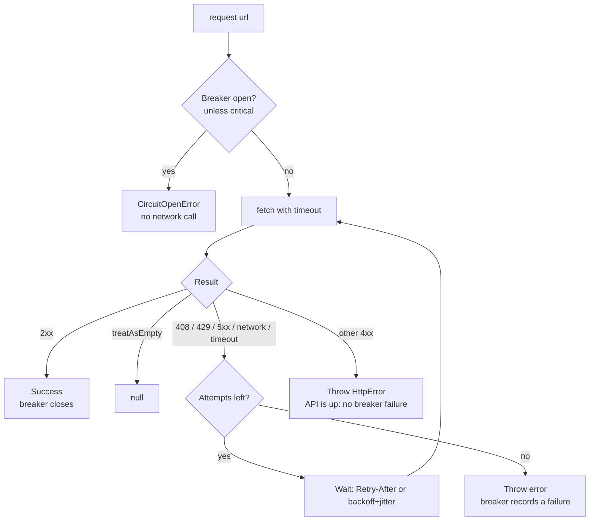

# http-guard

[](https://github.com/sergiogoqui-cpu/http-guard/actions/workflows/ci.yml)


A resilient `fetch` for **rate-limited, occasionally flaky APIs**: per-attempt timeouts, retries with exponential backoff and jitter, `Retry-After` support, and a **per-host circuit breaker** with a bypass for the critical path. Zero dependencies, built on the global `fetch`.

```ts
import { createGuard } from "http-guard";

const guard = createGuard({ timeoutMs: 8_000, retries: 3 });

const quote = await guard.json<{ price: number }>("https://api.example.com/quote?symbol=BTC");
```

## Why

`fetch` throws on network errors but happily returns a 429 or 503, never times out, and retries nothing. When an API degrades, naive code either gives up on the first blip or hammers a struggling service until it bans you.

| Problem | What `http-guard` does |
|---|---|
| Hanging requests | Per-attempt `timeoutMs` via `AbortController` |
| Transient 5xx / 408 / 429 / network errors | Retries with exponential backoff + jitter |
| Rate limits | Honours `Retry-After` (seconds or HTTP date) |
| An API that's down for minutes | **Circuit breaker** per host: fail fast instead of piling up requests |
| Being blind when it matters (e.g. reading the price of an open position) | `critical: true` bypasses the breaker |
| 404 that simply means "nothing there" | `treatAsEmpty: [404]` resolves `null` |
| API keys in error messages and logs | Errors only contain `origin + path`, never the query string or credentials |
| Cancelling | Your `AbortSignal` is respected and never retried |

## How a request flows



Breaker states: **closed** (normal) → **open** after `breakerThreshold` consecutive failed requests → **half-open** after `breakerCooldownMs` (one probe request) → **closed** if the probe succeeds, **open** again if it fails.

## Install

```bash
npm install github:sergiogoqui-cpu/http-guard
```

Requires Node 18+ (global `fetch`). Works in any runtime with a standards-compliant `fetch`.

## Usage

### Options

```ts
const guard = createGuard({
  timeoutMs: 10_000,        // per attempt
  retries: 3,               // extra attempts after the first
  baseDelayMs: 500,         // first backoff delay (doubles each time)
  maxDelayMs: 15_000,
  jitter: 0.2,              // ±20% spread
  breakerThreshold: 8,      // consecutive failed requests before opening
  breakerCooldownMs: 30_000,
  onEvent: (e) => logger.warn(e),   // { type: "retry" | "circuit", ... }
});
```

Every option can be overridden per call: `guard.json(url, { retries: 0, timeoutMs: 2_000 })`.

### Critical path

```ts
// Normal calls fail fast when the API is struggling...
await guard.json(candlesUrl);

// ...but the call you can't live without keeps trying.
const price = await guard.json(priceUrl, { critical: true });
```

Critical calls neither trip nor heal the breaker.

### Optional resources

```ts
const token = await guard.json(`/tokens/${id}`, { treatAsEmpty: [404] });  // null if not found
```

### POST and headers

```ts
await guard.json("https://api.example.com/orders", {
  method: "POST",
  headers: { "content-type": "application/json", authorization: `Bearer ${key}` },
  body: JSON.stringify(order),
  retries: 0,   // be careful retrying non-idempotent requests
});
```

### Health endpoint

```ts
guard.breakers();
// { "api.example.com": { state: "open", failures: 8, retryAfterMs: 21400 } }
```

### Errors

```ts
import { HttpError, TimeoutError, NetworkError, CircuitOpenError } from "http-guard";

try {
  await guard.json(url);
} catch (err) {
  if (err instanceof CircuitOpenError) { /* skip this cycle, retry in err.retryAfterMs */ }
  else if (err instanceof HttpError) { err.status; err.url; }   // url without query string
}
```

### Test your own code

Inject `fetch`, `sleep`, `now` and `random`:

```ts
const guard = createGuard({ fetch: fakeFetch, sleep: async () => {}, retries: 2 });
```

## API

| Export | Purpose |
|---|---|
| `createGuard(options)` | Returns `{ request, json, text, breakers }` |
| `CircuitBreaker` | The breaker on its own |
| `HttpError`, `TimeoutError`, `NetworkError`, `CircuitOpenError` | Error classes |
| `backoffDelay`, `parseRetryAfter`, `safeUrl` | Building blocks |

## Caveats

- Retrying non-idempotent requests (POST orders, payments) can duplicate side effects: set `retries: 0` or use idempotency keys.
- Breaker state lives in memory, per `createGuard()` instance.

## Development

```bash
npm install
npm test            # node:test, no extra framework
npm run typecheck
node examples/flaky-server.ts
```

## License

MIT. Issues and pull requests are welcome.
